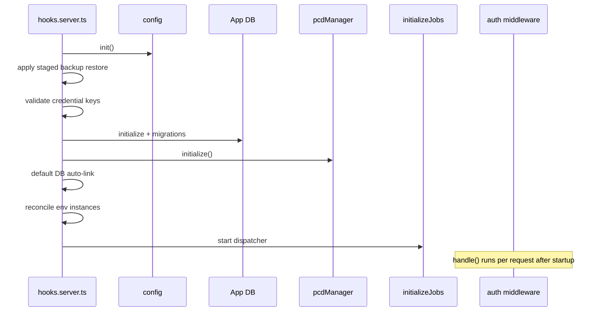

Praxrr initializes synchronously in `hooks.server.ts` before the SvelteKit server accepts
requests. Understanding **fail-fast** vs **warn-and-continue** steps helps diagnose
startup logs and encryption or PCD auto-link failures.

## Init Order

| Step | Action                                                                | On failure                                         |
| ---- | --------------------------------------------------------------------- | -------------------------------------------------- |
| 1    | Parser auto-spawn import (standalone builds)                          | Depends on build mode                              |
| 2    | `config.init()`                                                       | Startup aborts                                     |
| 3    | `applyPendingRestoreAtStartup()`                                      | Keeps live data; aborts if `data/` is missing      |
| 4    | `getActiveArrCredentialKeyVersion()`                                  | **Fail-fast** — logs error and throws              |
| 5    | `db.initialize()` + `runMigrations()`                                 | Startup aborts                                     |
| 6    | `appInfoQueries.updateVersion()`                                      | Startup aborts                                     |
| 7    | `logSettings.load()`                                                  | Startup aborts                                     |
| 8    | `logContainerConfig()` (Docker metadata)                              | Continues                                          |
| 9    | `pcdManager.initialize()`                                             | Startup aborts                                     |
| 10   | `trashGuideManager.initialize()`                                      | Startup aborts                                     |
| 11   | Plugin host when the UI flag is on                                    | **Warn-and-continue**                              |
| 12   | Default PCD auto-link (first run only)                                | **Warn-and-continue** — marks attempted            |
| 13   | `reconcileEnvInstances()`                                             | **Warn-and-continue** — logs reconciliation errors |
| 14   | `initializeJobs()` — recover running jobs, schedule, start dispatcher | Startup aborts                                     |
| 15   | Optional `arr.pull.startup` job when `pullOnStart` enabled            | **Warn-and-continue**                              |
| 16   | `cleanupExpiredSessions()`                                            | Continues                                          |
| 17   | `cleanupModeMismatchedSessions()`                                     | Continues                                          |
| 18   | `revokeOidcSessionsOnAllowlistChange()`                               | Startup aborts                                     |
| 19   | Server ready log + startup banner                                     | —                                                  |
| 20   | Auth middleware (`handle` export)                                     | Per-request                                        |

Empty `PRAXRR_DEFAULT_DB_URL` disables auto-link by design and marks setup complete
without retrying on every boot.

`applyPendingRestoreAtStartup()` runs only when the database is not already open, so a Vite
reload leaves a pending restore for the next real start. If the swap fails and `data/` is
missing, startup throws. The log names the `data.pre-restore-*` directory to move back to
`data/`. `cleanupModeMismatchedSessions()` removes sessions for local users when
`AUTH=oidc`, and sessions for OIDC users in every other mode.

## Sequence Diagram

In prose: configuration loads first, then any staged backup restore, then encryption
validation. The database and PCD caches compile next. Optional setup steps warn instead of
aborting, the job dispatcher starts, and expired and wrong-mode sessions are removed.
Under `AUTH=oidc`, a changed allowlist signs those users out. The first OIDC boot counts as
a change because no fingerprint is stored yet. Authentication applies on each HTTP request.

## Fail-Fast vs Warn-and-Continue

**Fail-fast** steps prevent the server from starting with invalid encryption material or
an inconsistent database/PCD state. Fix `ARR_CREDENTIAL_MASTER_KEY` configuration before
retrying.

**Warn-and-continue** steps include default database auto-link, environment instance
reconciliation, and optional startup pull job enqueue. These log warnings but allow the UI
to come up so operators can fix configuration in settings.

## Auth Middleware

After startup, every request passes through `handle`:

- First-run setup redirect when no local user exists. `AUTH=off` and `AUTH=oidc` do not use it. Under `AUTH=oidc`, password login returns 403 and `/auth/setup` redirects home.
- `AUTH=off` or local-network bypass after setup (dev-only modes)
- Public path allowlist
- Session sliding expiration for authenticated users. Past halfway, the database expiry is extended and the same cookie value is re-issued with the new expiry. `GET`/`HEAD` `/api/v1/events` and requests with `x-praxrr-live: 1` do not extend the session.
- 401 for unauthenticated API calls

See [Development Setup](/app/development/) for auth mode warnings.

## Source References

- `packages/praxrr-app/src/hooks.server.ts`
- `packages/praxrr-app/src/lib/server/jobs/init.ts`
- `packages/praxrr-app/src/lib/server/pcd/index.ts`
- `packages/praxrr-app/src/lib/server/utils/encryption/keys.ts`

## Related

- [Architecture Overview](/app/architecture/) — system context
- [Job System](/app/jobs/) — dispatcher started during init
- [PCD System](/app/pcd-system/) — cache compile on startup
- [Development Setup](/app/development/) — environment variables
- [Troubleshooting](/guides/troubleshooting/) — migration and auth errors
