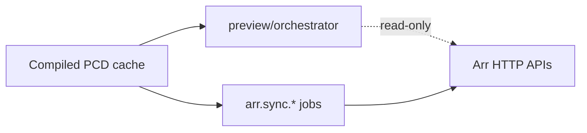

The **sync pipeline** transforms compiled PCD state into Arr API operations. Preview
(dry-run) and execution are separate code paths. Section support is declared per
`arr_type` in `mappings.ts` — Radarr, Sonarr, and Lidarr do not share identical
semantics even when API shapes look similar.

User workflows: [Syncing Profiles](/guides/syncing-profiles/). This page covers internals.

## Section Registry

Sync work is organized into sections registered in `sync/registry.ts`:

| Section            | Handler import                |
| ------------------ | ----------------------------- |
| `qualityProfiles`  | `qualityProfiles/handler.ts`  |
| `delayProfiles`    | `delayProfiles/handler.ts`    |
| `mediaManagement`  | `mediaManagement/handler.ts`  |
| `metadataProfiles` | `metadataProfiles/handler.ts` |

Each section implements `SectionHandler` with syncers extending `BaseSyncer`. Handlers
register via side-effect imports in `sync/processor.ts`.

## Per-`arr_type` Dispatch

`sync/mappings.ts` defines supported sections per app:

| Arr type | Supported sections                              |
| -------- | ----------------------------------------------- |
| `radarr` | qualityProfiles, delayProfiles, mediaManagement |
| `sonarr` | qualityProfiles, delayProfiles, mediaManagement |
| `lidarr` | all four including metadataProfiles             |

`isSyncSectionSupported()` and related helpers **fail fast** with explicit error messages
when a section is requested for an unsupported `arr_type`. Media management subsections
(mediaSettings, naming, qualityDefinitions) are also gated per app.

## Preview Path (Read-Only)

Preview never mutates Arr state:

1. API: `POST /api/v1/sync/preview` (see OpenAPI reference)
2. `processor.ts` → `generatePreview()` in `preview/orchestrator.ts`
3. Orchestrator walks `SYNC_SECTION_ORDER`, invokes section syncers in preview mode
4. Returns per-section creates/updates/deletes and accumulated errors

Preview is safe to repeat while resolving PCD conflicts or selection mismatches.

## Reviewed Preview Apply Boundary

Creating a Sync Preview also creates a private, versioned review binding in the
process-local TTL preview store. The binding is not returned by the preview API and is
not written to the application database. A process restart or normal preview expiry
therefore invalidates it safely rather than restoring an old authorization.

The binding covers the exact reviewed:

- instance ID and explicit `arr_type`
- successfully generated section set and the subset selected for Apply
- effective per-section configuration, including transient preview configuration
- desired PCD/config evidence, relevant live Arr evidence, and material plan for each
  section

Apply first atomically claims the ready preview (`ready` → `applying`). The reviewed
executor then claims every selected section as one operation without resetting another
sync's active claim. After the claims are held, it reloads the exact enabled instance,
dispatches through its stored Radarr, Sonarr, or Lidarr type, and re-materializes separate
PCD/config, live Arr, and material-plan evidence for every selected section. Every
selected section must match before Praxrr creates snapshots, captures Sync History,
records confirmed outcomes, or performs the first Arr write.

A PCD-only, Arr-only, combined, scope, or unverifiable mismatch returns a typed 422
invalidation. The entire selected apply is rejected with zero writes, no Sync History
run, and no confirmed entity outcomes. The old diff remains read-only; the UI states
that nothing was applied and requires the operator to generate and review a new preview.

On a match, each syncer receives the prepared values produced during revalidation and
the same effective section configuration that was reviewed. The planned changes remain
review evidence, not proof of execution. Only actual writer results become confirmed
entity outcomes and Sync History evidence.

This is an all-selected-before-any-write application boundary, not a transaction across
upstream Arr APIs. Radarr, Sonarr, and Lidarr do not expose one common conditional-write
contract, so an external actor can still change Arr state after Praxrr's final validation
read and before a write. Praxrr narrows that interval with prepared values and available
value guards, but does not claim durable preview authorization or upstream atomicity.

## Execution Path

Execution runs through job handlers and direct processor calls:

| Trigger     | Entry point                                                       |
| ----------- | ----------------------------------------------------------------- |
| `on_pull`   | `triggerSyncs()` after PCD git pull                               |
| `on_change` | `triggerSyncs()` after PCD file/ops change                        |
| `schedule`  | Cron evaluation in `evaluateScheduledSyncs()` → `arr.sync.*` jobs |
| Manual      | UI or API enqueue of sync jobs                                    |

`arr.sync.*` job handlers invoke section syncers with live Arr clients from
`arrInstanceClients.ts`. Concurrency for multi-instance preview is bounded; execution
uses similar batching in `processor.ts`.

Startup pull marks instances active to prevent redundant `on_pull` fanout while
reconstructing selections from live Arr state.

## Pipeline Flow



In prose: both preview and execution read compiled PCD state. Preview diffs against Arr
without writes. Reviewed Preview Apply adds the private validation boundary above before
calling the existing writers. Jobs and matched reviewed applies perform the actual push.

## Ownership Ledger and Pruning

The `arr_managed_entities` table is a per-instance **ownership ledger**. Only a
confirmed `create` outcome for a custom format or quality profile inserts a row;
a confirmed `update` refreshes `last_synced_at`/`arr_name` on an existing row but
never adopts a same-named foreign entity (`sync/ownership/record.ts`). There is no
backfill: entities that predate the ledger stay unmanaged and are reachable only
through cleanup with `includeUnmanaged`.

When an instance has `prune_removed_managed = 1`, the quality-profiles section plans
deletions for ledger-owned entities that are no longer in the expected configuration
(`sync/ownership/planPrunes.ts`):

- A ledger row becomes a prune candidate only when the live entity with the same
  remote id still carries the exact recorded `arr_name` (guards against id reuse).
- Quality profiles still assigned to media are blocked and listed as
  **Kept (in use)**. That media lookup runs only while building a reviewed
  preview or re-materializing it for apply. Drift checks, sync-history
  capture, MCP previews, and canary previews do not download the library;
  those quality profiles stay blocked as unverified and are not deleted.
- A custom format scored by any surviving live quality profile, or by any
  desired profile, is kept. It is not listed under Kept (in use). A blocked
  or skipped quality-profile delete also keeps the formats that profile scores.
- If a selected PCD profile is missing from its source, that database keeps
  its namespace so a later sync does not collide with another source.
- Prunes appear in the preview as `action: 'delete', managed: true` and are hashed
  into the review binding's `planHash`, so they exist **only** inside the reviewed
  preview → apply path. Scheduled, `on_pull`, `on_change`, and canary syncs never
  delete.

On a matched apply, `sync/ownership/executePrunes.ts` deletes quality profiles
before custom formats. Each item is re-read with a fresh GET immediately before
DELETE. A name that no longer matches is skipped (`Arr entity changed since review;
not deleted`) and the ledger row is kept. HTTP 404 counts as success and drops
the row. Any other failure keeps the row. If an earlier write in the section
failed, every reviewed delete is skipped with an explicit outcome and the section
fails. When sync history is disabled, the deletes still run and a warning is
logged because they will have no history record. Applying sections that contain
managed deletes requires the `admin` scope for API tokens.

Confirmed prune deletes flow into Sync History like other outcomes, and planned
managed deletes appear in drift under the `prune` category. That includes ledger-owned
quality profiles listed in the preview's `blockedPrunes` (in use, or in-use status
unverified): drift classifies their delete rows as `prune`, not `unmanaged`, even though
they will not be deleted until a reviewed preview verifies them. Changing an instance's
`url` or `type` clears its ledger rows. The cleanup API (`POST /api/v1/arr/cleanup`)
scans ledger-managed items by default; `includeUnmanaged: true` restores the legacy
full scan.

## Drift Remediation

Drift detection compares each instance's live configuration with the compiled PCD state
(see the drift dashboard). Three opt-in tools act on a stored drift row: **reconcile**
(a human applies a reviewed fix), **acknowledge / snooze** (mute an intentional divergence),
and a per-instance **remediation policy** (`off`, `notify`, or `auto`). All three resolve
the instance by its own `arr_type`; a policy, section list, or Canary cohort is never
borrowed from a sibling Arr app.

### Drift event identity

A drift event is `(instance, driftSignature, driftDetectedAt)`. `driftSignature` is the
hash of the alerting changes (managed `drift` updates and `missing` creates). Each change
also has a stable `key` (`section|entityType|name|remoteId|action`) in the drift detail
response. `driftDetectedAt` is set by the first content refresh that sees the current
signature. It stays the same while the signature stays the same, gets a new value when the
signature changes (including an identical drift that comes back after recovery), and is
`null` when nothing alerts. A check that fails or degrades keeps the previous value along
with the previous content.

### Reconcile (manual)

`POST /api/v1/drift/{instanceId}/reconcile` builds a reviewed Sync Preview limited to the
drifted sections. It never writes to the Arr.

1. The stored row must be `drifted` with a signature, have fresh content
   (`contentCheckedAt` not null), and match the instance's `arr_type`. Otherwise the route
   returns 409.
2. The section set (`reconcilableSections` in the drift detail) is the sections that have
   alerting changes, limited to sections that are configured for the instance and available
   at its detected Arr version, in sync order. Acknowledgements do not filter it: a human may
   revert an acknowledged change. An empty set returns 409.
3. An optional `{ "sections": [...] }` body can narrow the set but never widen it. A
   requested section that is not reconcilable returns 400.
4. The preview is created through the shared reviewed-preview core, so it has the same
   rate limit, store capacity (429), and failure snapshot (500) as `POST /sync/preview`.
   The stored snapshot carries a server-owned `driftRemediation` link
   (`instanceId`, `driftSignature`, `driftDetectedAt`, `trigger: 'reconcile'`).
   `POST /sync/preview` ignores any `driftRemediation` a client puts in its body, and the
   create core rejects a link for a different instance.

You apply the preview through `POST /api/v1/sync/preview/{previewId}/apply`, the same path
and the same boundary described in [Reviewed Preview Apply Boundary](#reviewed-preview-apply-boundary):
claim, staleness check, re-materialization, and the `admin` scope for managed deletes. The
apply core reads the link only from the stored snapshot. On execution:

- The Sync History row stores `drift_signature`, `drift_detected_at`, and
  `remediation_trigger`. The API exposes them as `driftSignature`, `driftDetectedAt`, and
  `remediationTrigger`.
- The drift row's `lastRemediation` (`trigger`, `status`, `signature`, `at`,
  `syncHistoryId`) is stamped at the exact executing instance. The status is the run's
  history status (`success`, `partial`, `failed`, or `skipped`). If execution fails after
  side effects started, the status is `failed` with no history id.
- A 422 invalidation writes nothing to Sync History and records no remediation.

### Acknowledge and snooze

`PUT /api/v1/drift/{instanceId}/suppression` replaces the whole suppression state:

```json
{
  "expectedSignature": "<driftSignature the user reviewed>",
  "acknowledgeInstance": false,
  "acknowledgedEntityKeys": ["qualityProfiles|qualityProfile|HD|12|update"],
  "snoozedUntil": null
}
```

To clear everything, send `false`, `[]`, and `null`. The update is value-guarded on
`expectedSignature`. The route checks it before any ack or snooze check, and the `UPDATE`
checks it again atomically, so a signature that changes underneath the user returns 409.
Other validation:

- Adding an acknowledgement (a new instance ack or a new entity key) needs a `drifted` row.
  Re-sending acks that are already stored is allowed at any status, so a snooze can be set
  while the instance is unreachable. Entity keys must be current alerting keys; unknown keys
  return 400. Duplicate keys are collapsed.
- `snoozedUntil` must be a valid date-time in the future and no more than **90 days** away
  (`DRIFT_SNOOZE_MAX_MS`).
- An instance that has never been checked returns 400.

Acknowledgements cover the **content** the user reviewed, not only which entity drifted. The
server records a fingerprint of each acknowledged change (its key plus its field-level diff).
For an instance ack it records a content signature over all alerting changes. The key-only
`driftSignature` is still the notification dedup key and the `expectedSignature` guard.

| Mode         | Scope                       | Lasts until                                                                                                                                                            |
| ------------ | --------------------------- | ---------------------------------------------------------------------------------------------------------------------------------------------------------------------- |
| Instance ack | Whole instance              | Any alerting change is added, removed, or edited (field diff). The next content refresh clears it (value-guarded) and it does not return                               |
| Entity ack   | One alerting change (`key`) | That entity stops being an alerting change **or its field diff changes** (same key, drifted further). Every content refresh drops acks whose content no longer matches |
| Snooze       | Whole instance only         | `snoozedUntil` passes. Signature changes do not end a snooze                                                                                                           |

`suppression.state` is `none`, `acknowledged`, `snoozed`, or `partially_acknowledged`.
Acknowledging every alerting entity one by one counts as `acknowledged`. Suppression is
derived at read time and never rewrites the stored row. `status` stays `drifted`, and the
summary totals, `praxrr_drift_*` metrics, and MCP drift status still report the real drift.
Suppression changes only two things:

- **Notifications.** `drift.detected` fires only when the **effective** signature (the
  hash of the alerting keys not yet acknowledged) is not null and differs from
  `notified_signature`. That signature is stored after each send. An instance that is
  acknowledged or snoozed never alerts. Acknowledging some entities of a drift that was
  already notified does not alert again for the rest: saving the ack moves the dedup key to
  the narrowed set. A new un-acknowledged entity that drifts later does alert. Clearing or
  shrinking an ack exposes those entities again, and they alert on the next content refresh.
  The message counts and entity lines list only un-acknowledged changes. When a snooze
  expires, alerting resumes for drift that differs from what was last notified. Drift that
  was already notified before the snooze is not sent again.
- **Config Health.** If the instance is snoozed or acknowledged, the drift criterion scores
  100 with a note ("Drift snoozed until …" or "Drift acknowledged until the drifted set
  changes"). A partial acknowledgement applies the penalty only to the un-acknowledged
  drifted and missing counts. Stale content is still unscored. An expired snooze or a
  cleared ack gets the full penalty again.

### Remediation policy

`GET` / `PUT /api/v1/drift/{instanceId}/remediation-policy` with
`{ "mode": "off" | "notify" | "auto", "allowedSections": [...] }`. If no row is stored, or the
stored row was written for a different `arr_type`, the response is the default:
`mode: 'off'`, no sections, `updatedAt: null`. On `PUT`, each section must be a known sync
section that the instance's own `arr_type` supports. Duplicates are rejected, and `auto`
needs at least one section.

| Mode     | Behavior                                                                                                                                                                                                                                                                               |
| -------- | -------------------------------------------------------------------------------------------------------------------------------------------------------------------------------------------------------------------------------------------------------------------------------------- |
| `off`    | Default. No remediation; `drift.detected` behaves as before                                                                                                                                                                                                                            |
| `notify` | Writes nothing. When `drift.detected` fires, it adds `Reconcile suggested: <sections> — /drift/{id}`. The suggested sections are those with alerting changes, minus any section with an active (content-matching) entity ack, narrowed to `allowedSections` when the list is not empty |
| `auto`   | Opt-in auto-remediation of the allowed sections (below)                                                                                                                                                                                                                                |

### Auto-remediation

The drift check never writes to an Arr. After every successful content refresh (the
scheduled sweep or `POST /api/v1/drift/{id}`), `queueAutoRemediationIfEligible` runs a pure
decision for the enabled instance. Each rule below is checked in order, and the first one
that applies decides the outcome:

1. The mode is not `auto` → skip.
2. The row is not `drifted` with a signature → skip. **Auto never writes unless the
   instance is drifted.**
3. The content is stale or the row's `arr_type` does not match → skip.
4. The instance is snoozed or fully acknowledged → skip.
5. This signature was already attempted (`last_auto_attempt_signature`) → skip.
6. Target sections = sections with alerting changes, **minus any section containing an
   active entity ack** (one whose fingerprint still matches; an ack on an entity that drifted
   further no longer blocks), ∩ `allowedSections` ∩ sections available at the detected Arr
   version. Empty → skip.
7. A target section is already syncing → skip.
8. A Canary rollout of the same `arr_type` is `canary_running`, `awaiting_confirmation`, or
   `rolling_out` → skip.
9. Canary is enabled, the enabled same-`arr_type` cohort has more than one instance, and
   this instance is not the resolved default canary → **hold**. Auto claims the signature,
   records `lastRemediation.status = 'held_canary'`, and sends
   `drift.remediation.held`, once per signature. It writes nothing; a human reconciles.
10. Otherwise it upserts one `drift.remediate` job:
    `{ instanceId, driftSignature }`, dedupe key `drift.remediate:{instanceId}`, source
    `system`. A running job is never overridden, so remediations never stack.

The `drift.remediate` handler never trusts the decision made at enqueue time:

1. It re-runs the decision. If the result is no longer `remediate`, or the stored signature
   differs from the job payload, it cancels.
2. It claims the attempt with `markAutoAttempt` before any I/O. The claim is value-guarded
   on the stored drift signature, which gives **one attempt per signature**, even across
   concurrent runs. If the signature moved on, the job cancels as stale.
3. It creates a drift-tagged reviewed preview (`trigger: 'auto'`) for the target sections.
   If the preview is rejected (rate limit, capacity, store failure) or fails, nothing was
   written: the handler **releases** the claim, records nothing, sends no notification, and
   the next drift refresh re-enqueues.
4. It drops any section whose preview contains **managed deletes**, because auto never
   deletes. Then the preview's own alerting signature over the remaining sections must equal
   the stored signature for those sections. If no section remains or the signatures differ,
   it records `skipped` and cancels without sending a notification.
5. It applies through the same reviewed-apply core as the human route (`source: 'system'`).
   That records the drift-linked Sync History row and `lastRemediation`, as described above.
   An apply rejected before the reviewed executor runs (stale or invalidated review, a
   section already syncing, preview no longer ready) also releases the claim silently.
6. It sends `drift.remediation.applied` on success. A partial run (Sync History status
   `partial`) sends `drift.remediation.failed` with "partially applied" copy. An unsuccessful
   apply, an unexpected apply error, or an exception after apply started sends
   `drift.remediation.failed`, records `failed` when no Sync History row was linked, and keeps
   the claim. Then it re-runs the drift check, and the attempt claim prevents a loop.

`lastRemediation` only moves forward: an outcome for an older signature never overwrites the
record of the current drift event. Sync History keeps every run regardless.

A failed, partial, or held attempt is not retried for the same signature. A new signature arms auto
again. So does a genuine recovery: a fresh content check with no alerting drift clears
`last_auto_attempt_signature` at the same point where `notified_signature` is cleared, so a
drift that later returns counts as a new event. While a `drift.remediate` job is running,
the Arr sync page shows the policy's allowed sections as in progress.

### Token scopes

| Route                                       | Scope                                              |
| ------------------------------------------- | -------------------------------------------------- |
| `POST /api/v1/drift/{id}/reconcile`         | `read` (dry run, ephemeral in-memory preview)      |
| `POST /api/v1/sync/preview/{id}/apply`      | `sync:apply` (`admin` for managed-delete sections) |
| `GET /api/v1/drift/{id}/remediation-policy` | `read`                                             |
| `PUT /api/v1/drift/{id}/suppression`        | `admin` (fail-closed default)                      |
| `PUT /api/v1/drift/{id}/remediation-policy` | `admin` (fail-closed default)                      |

Session principals pass through as on every other route. CSRF protection is global.

## Contract Notes

- Do not assume cross-Arr field parity when reading or extending syncers.
- Config names used as sync lookup keys must match persisted identifiers exactly.
- Quality profile compatibility filtering uses app-compatible quality names, not
  `arr_type='all'` scores alone.
- Reviewed validation and execution always dispatch through the binding's explicit
  `arr_type`; there is no sibling-Arr fallback.
- A reviewed preview authorizes a bounded attempt only while its private TTL binding and
  all selected evidence still match. Confirmed outcomes describe actual writes and are a
  separate contract.

## Source References

- `packages/praxrr-app/src/lib/server/sync/processor.ts`
- `packages/praxrr-app/src/lib/server/sync/preview/orchestrator.ts`
- `packages/praxrr-app/src/lib/server/sync/preview/reviewBinding.ts`
- `packages/praxrr-app/src/lib/server/sync/preview/store.ts`
- `packages/praxrr-app/src/lib/server/sync/mappings.ts`
- `packages/praxrr-app/src/lib/server/sync/registry.ts`
- `packages/praxrr-app/src/lib/server/sync/ownership/record.ts`
- `packages/praxrr-app/src/lib/server/sync/preview/create.ts`
- `packages/praxrr-app/src/lib/server/sync/preview/apply.ts`
- `packages/praxrr-app/src/lib/server/sync/drift/persist.ts`
- `packages/praxrr-app/src/lib/server/sync/drift/suppression.ts`
- `packages/praxrr-app/src/lib/server/sync/drift/remediation.ts`
- `packages/praxrr-app/src/lib/server/jobs/handlers/driftRemediate.ts`
- `packages/praxrr-app/src/lib/server/db/queries/driftStatus.ts`
- `packages/praxrr-app/src/lib/server/db/queries/driftRemediationPolicy.ts`
- `packages/praxrr-app/src/lib/server/utils/auth/scopePolicy.ts`
- `packages/praxrr-app/src/lib/server/sync/ownership/planPrunes.ts`
- `packages/praxrr-app/src/lib/server/sync/ownership/executePrunes.ts`
- `packages/praxrr-app/src/lib/server/db/queries/arrManagedEntities.ts`
- `packages/praxrr-app/src/lib/server/jobs/handlers/arrSync.ts`

## Related

- [PCD System](/app/pcd-system/) — compiled state preview and sync read from
- [Job System](/app/jobs/) — `arr.sync.*` scheduling and execution
- [Syncing Profiles](/guides/syncing-profiles/) — user guide
- [Architecture Overview](/app/architecture/) — data flow summary
- [Notifications](/app/notifications/) — `drift.detected` and `drift.remediation.*` events
- [Troubleshooting](/guides/troubleshooting/) — preview and sync errors
