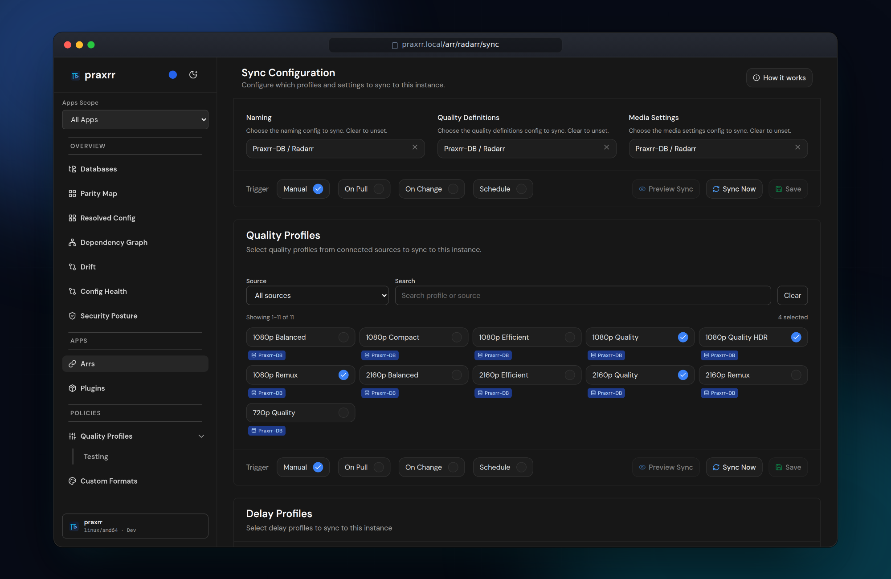
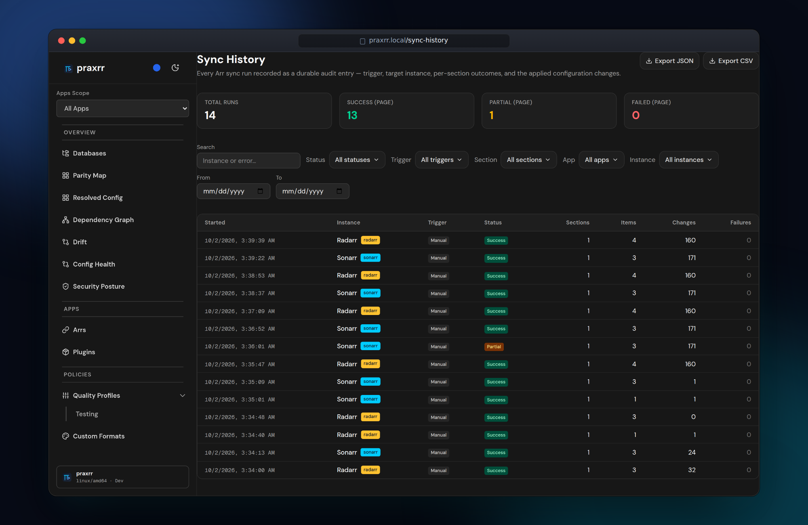

Sync pushes compiled PCD configuration to connected Arr instances. Each instance
has independent sync selections, triggers, and preview state per section.

## Sync sections

Depending on `arr_type`, an instance may expose:

- **Quality profiles** (with dependent custom formats)
- **Delay profiles**
- **Media management**
- **Metadata profiles** (Lidarr)

Open **Arr → {instance} → Sync** to enable profiles from each linked PCD and
configure when pushes run.

## Sync triggers

Each section supports a trigger mode:

| Trigger     | When sync runs                       |
| ----------- | ------------------------------------ |
| `on_change` | After local PCD or selection changes |
| `on_pull`   | After the PCD repository is pulled   |
| `schedule`  | On a cron expression (UTC)           |

Scheduled syncs use standard cron syntax (for example `0 * * * *` hourly).
Praxrr evaluates schedules during the job processor cycle.

Optional startup pull (`PULL_ON_START=true`) reconstructs selections from live
Arr state without immediately overwriting remote configuration.

## Preview before apply

**Sync Preview** generates a read-only diff between desired PCD state and the
current Arr API state:

1. On the **Sync** page, open the preview panel.
2. Praxrr fetches remote entities and compares field-level changes.
3. Review summary counts: creates, updates, deletes, unchanged.

Preview runs per section (quality profiles, delay profiles, etc.). Quality
profile preview includes custom formats referenced by selected profiles.

Preview does not modify Arr. Use it as a dry-run gate before **Apply Preview**,
**Sync now**, or enabling aggressive triggers.

### Apply the reviewed preview

**Apply Preview** authorizes only what you reviewed: the displayed instance and Arr
family, the eligible sections you selected, their effective configuration, and the
underlying desired PCD and live Arr evidence. Praxrr keeps the corresponding review
binding privately in memory for the preview's limited lifetime; it is not durable across
a restart.

Before anything is written, Praxrr:

1. Claims the preview and all selected sections so another sync cannot take over that
   reviewed work.
2. Reloads the exact instance and dispatches explicitly as Radarr, Sonarr, or Lidarr.
3. Rebuilds the PCD/config evidence, live Arr evidence, and material plan separately for
   every selected section.
4. Confirms every selected section still matches the review before allowing the first
   write.

If any selected evidence changed or cannot be verified, the entire apply stops with
zero writes. The alert names the affected evidence class and sections, says that nothing
was applied, and keeps the old diff visible as read-only evidence. Choose **Generate a
new preview**, review the replacement diff, and apply that new preview instead. An
invalidated preview cannot be retried.

The entries in a preview are planned changes. After a matched apply begins, confirmed
outcomes show what Arr actually accepted, skipped, or failed and may link to Sync
History. Planned changes and confirmed outcomes are deliberately displayed separately;
a plan is never treated as proof that a remote write happened.

Praxrr validates all selected sections before its first write, but the supported Arr
APIs do not provide one shared transaction or conditional-write mechanism. A separate
external Arr editor can still race between Praxrr's final read and write. If you expect
concurrent edits, coordinate them and generate a fresh preview immediately before Apply.

## Pruning removed entities

When you remove a custom format or quality profile from your database, sync normally
just stops pushing it — the copy already in Arr stays behind. **Pruning** is an
opt-in, per-instance policy that deletes those leftovers, but only the ones Praxrr
itself created.

### What the ownership ledger records

Praxrr keeps an **ownership ledger** per instance. A row is written only when a sync
**creates** a custom format or quality profile on that instance. A successful update
merely refreshes the existing row — it never adopts an entity Praxrr did not create.
Anything you made by hand in Arr is never recorded and never pruned.

The ledger starts empty and there is **no backfill**: custom formats and profiles
that already existed in Arr before this feature (or before you connected the
instance) stay _unmanaged_ forever. To find and remove those, use the instance's
**Cleanup** tool with **Include unmanaged items** turned on.

### Enabling pruning

Pruning is off by default. Enable it per instance under
**Arr → {instance} → Settings** with the **Prune removed managed entities** toggle.

### When deletions happen

Deletes run **only** when you apply a reviewed sync preview. You always see the
exact list of deletions first:

- Ledger-owned items that will be removed appear as **Managed — will be deleted**.
- Items Praxrr did not create appear as **Left in Arr**. They are not removed.
- A quality profile that is still assigned to media, or whose media use could not
  be checked, appears as **Managed — kept (in use)** and is listed under
  **Kept (in use)**.

Scheduled, `on_pull`, `on_change`, and canary syncs never delete. Applying the
sections that contain managed deletions also requires an API token with the
**admin** scope; a sync-only token can still apply other sections in the same
preview.

### What is kept

Praxrr does not delete a quality profile that is still assigned to media. On a
reviewed preview it checks the library before planning that delete. Drift checks
and other non-reviewed previews do not download the library; those profiles stay
listed as kept because their use was not verified.

A custom format that any remaining quality profile still scores is kept. It is
not listed under **Kept (in use)**; it is simply not deleted. That includes a
format scored by a profile this apply did not remove. Quality profiles are
deleted before custom formats, so a format referenced only by a profile removed
in the same apply can still be pruned.

Before each delete, Praxrr reads the live entity again. If the name no longer
matches, the item is left in place. If Arr already removed it, the delete counts
as done.

### Housekeeping

- Changing an instance's **URL** or **type** clears its ledger, since the recorded
  remote ids no longer refer to the same server. Pruning starts fresh from the next
  creates.
- Planned managed deletions also show on the **Drift** pages as **Pending removal**. This
  includes Praxrr-created quality profiles that are blocked because they are still
  assigned to media or because their usage could not be verified. They are not deleted
  until a reviewed preview confirms they are unused.
- The **Cleanup** tool scans only ledger-managed items by default; toggle
  **Include unmanaged items** to scan everything.

## Run a sync

- **Sync now** on a section pushes pending changes immediately.
- **Save** persists selection and trigger changes without syncing.
- Background jobs process pending syncs with bounded concurrency across
  instances.

The sync pipeline for each section:

1. Fetch selected entities from the compiled PCD cache.
2. Transform to Arr-specific API payloads.
3. Push creates, updates, and deletes through the Arr REST client.

Logs for each run appear under **Arr → {instance} → Logs**. **Sync History** keeps a durable,
exportable audit entry for every run across all instances.

### Live progress

The sync page updates on its own while a job runs; you do not need to reload.

- **Section chip:** each section's footer shows **Queued** when a sync is
  waiting, **Syncing…** while it runs, and **Last sync failed** when the most
  recent run failed.
- **Completion toasts:** when a job finishes, a toast reports the result with
  a **View details** link to its Sync History entry or to **Settings → Jobs**.
  Failure toasts stay until you dismiss them.
- **Which jobs toast:** jobs you start manually always toast. Background sync
  failures toast too, at most one per minute for each job type and target
  (instance or database). A toast for a repeated failure replaces the previous
  one instead of stacking. Successful background runs stay quiet.
- **Connection indicator:** if the live connection drops, a small
  **Reconnecting…** indicator appears. If Praxrr cannot reconnect, it shows
  **Live updates paused**. Pages keep working without live updates; reload or
  navigate to see the latest state.

## Base ops vs user ops

PCD state has two layers:

- **Base ops:** Published canonical state from the linked repository. Updated
  when you pull upstream changes.
- **User ops:** Local overrides that persist across pulls. Stored as append-only
  SQL operations in `pcd_ops`.

When upstream base ops change the same field you edited locally, Praxrr uses
value guards to detect conflicts. Resolve conflicts on the database **Changes**
or **Conflicts** pages before expecting sync to apply cleanly.

## Pull upstream changes

When the PCD remote has new commits:

1. Open **Databases → {database}** and pull or sync the repository.
2. Review **Changes** for diffs against your local user ops.
3. Resolve conflicts if prompted.
4. Re-run **Preview** on affected instances before syncing.

Non-Git local-path PCD sources skip commit history features but still support
entity editing and sync.

## Conflict resolution

If sync fails because remote Arr state diverged:

1. Check the reviewed-preview alert or preview errors for the affected evidence and
   section.
2. Compare PCD **Changes** with Arr UI state.
3. Adjust user ops or Arr selections, then generate and review a new preview.

Avoid blind force-syncing over manual Arr edits you intend to keep.

## Next steps

- [Quality Profiles](./quality-profiles/) — profile structure and scoring
- [Custom Formats](./custom-formats/) — format entities synced with profiles
- [Troubleshooting](./troubleshooting/) — sync error messages
