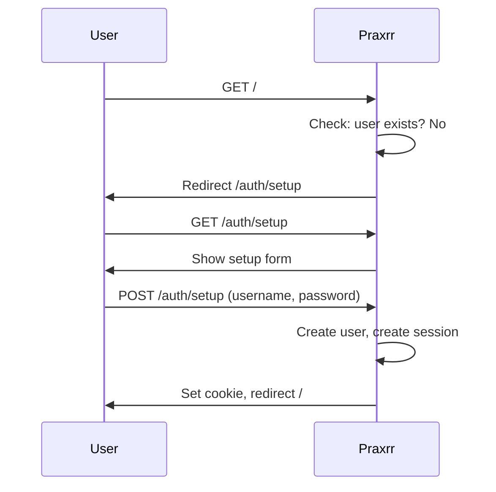
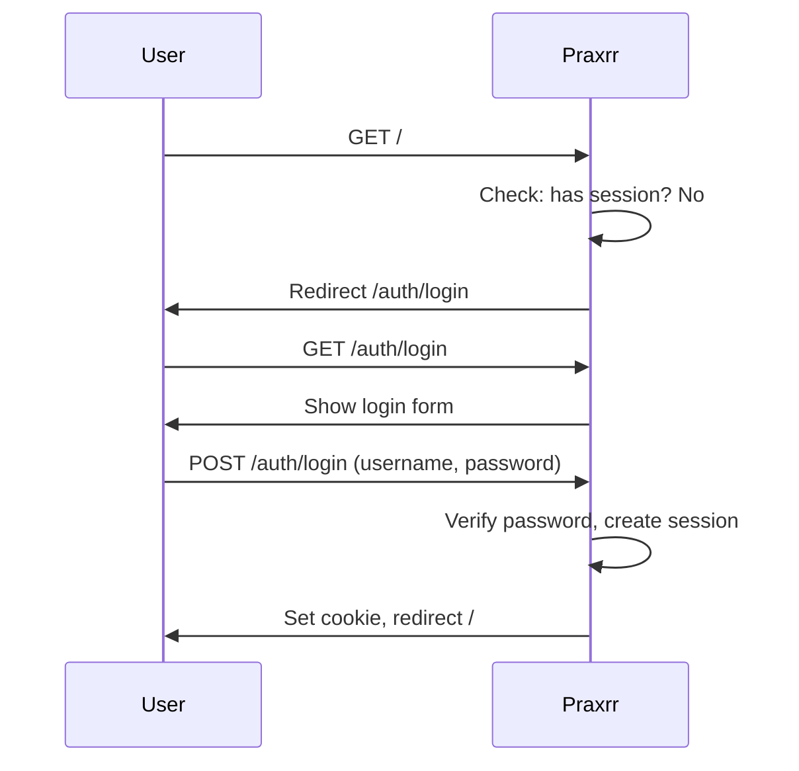
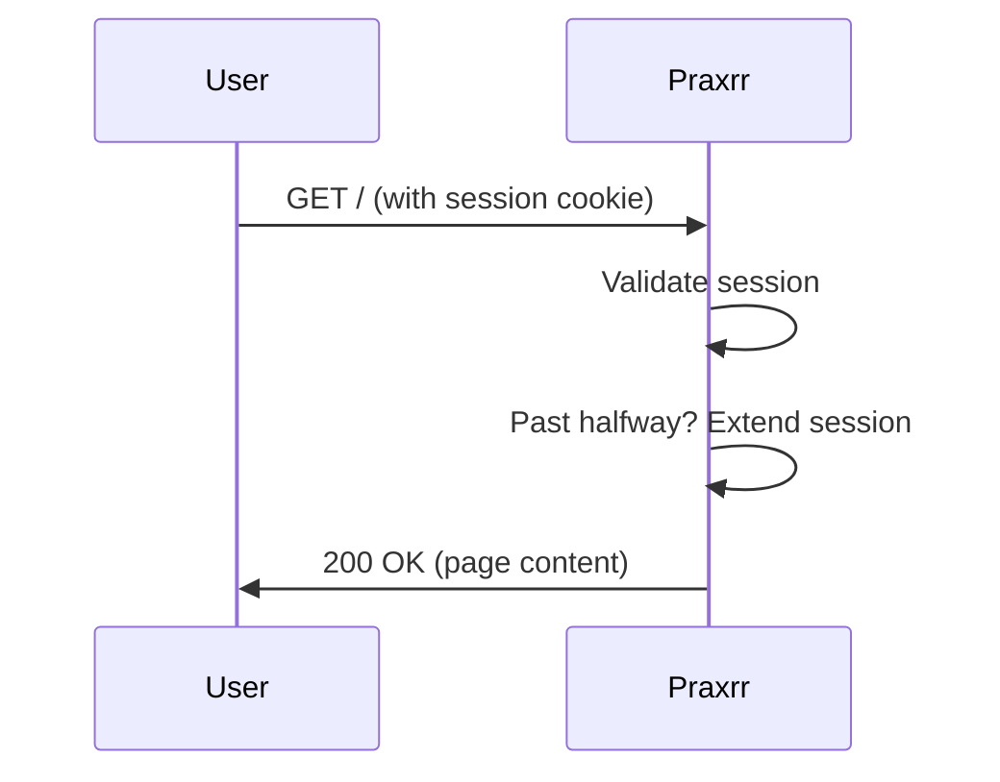
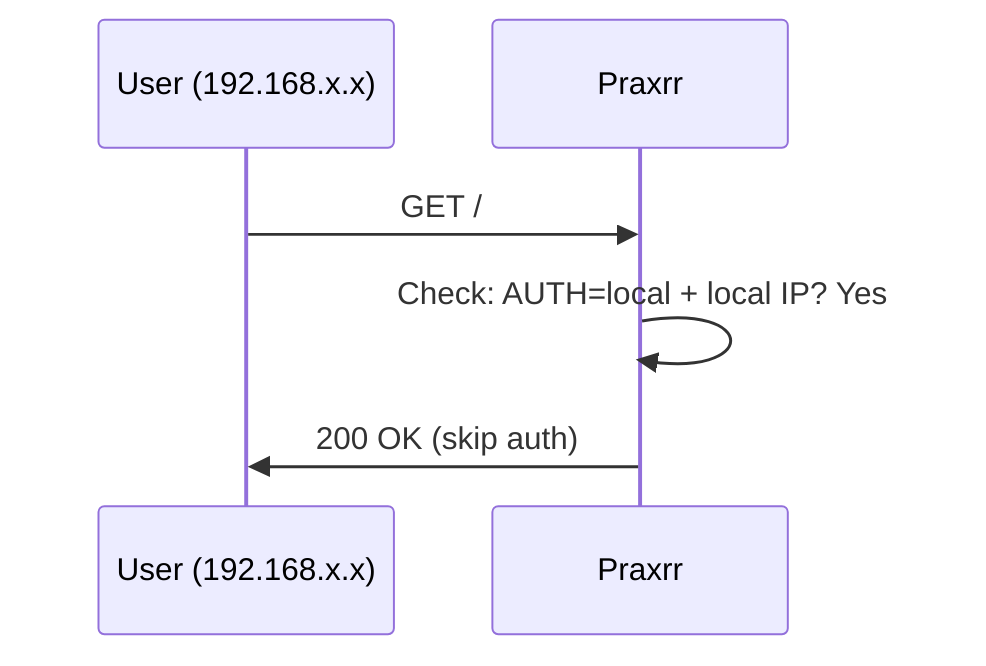
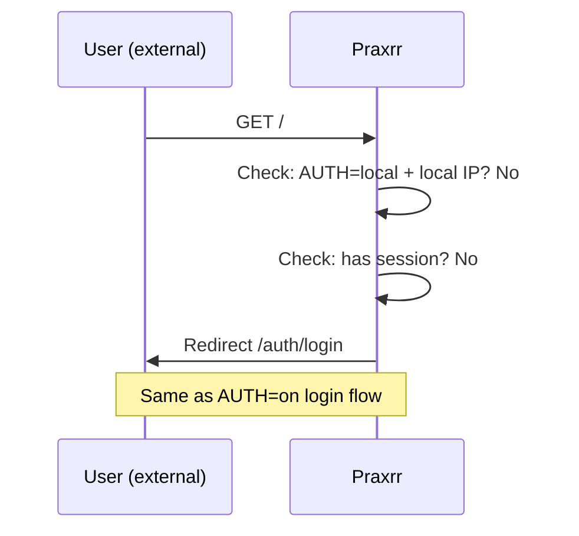
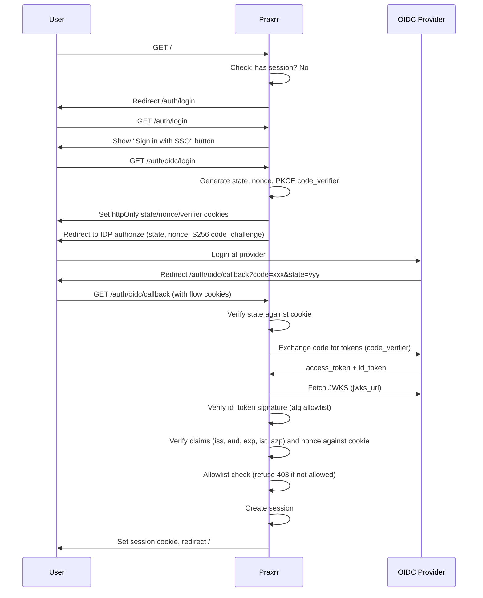
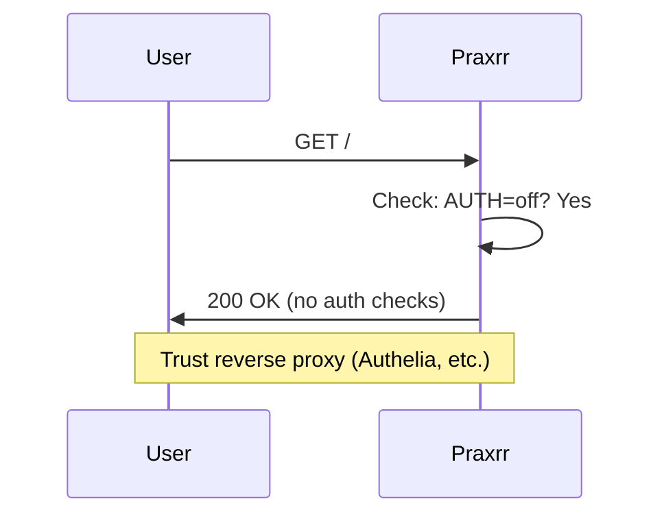

# Auth Module

Authentication and session management for Praxrr.

## Auth Modes

Controlled by the `AUTH` environment variable:

| Mode    | Description                                                    |
| ------- | -------------------------------------------------------------- |
| `on`    | Default. Username/password required for all requests           |
| `local` | Skip auth for local IPs (192.168.x.x, 10.x.x.x, etc.)          |
| `off`   | Disable auth entirely (trust reverse proxy like Authelia)      |
| `oidc`  | Login via external OIDC provider (Google, Authentik, Keycloak) |

## Sequence Diagrams

### AUTH=on (Default)

#### First Run (No User)



#### Login Flow



#### Authenticated Request



### AUTH=local

#### Local IP



#### External IP



#### Client IP resolution and `TRUSTED_PROXY` (issue #228)

The "local IP" decision uses `getClientIp()` (`network.ts`). Forwarded headers
(`X-Forwarded-For`, `X-Real-IP`, …) are **spoofable**, so they are honored
**only** when the direct socket peer (`event.getClientAddress()`) is in the
`TRUSTED_PROXY` allowlist:

- **Untrusted / no proxy (default):** forwarded headers are ignored; the request
  is graded by its real socket peer. A forged `X-Forwarded-For: 127.0.0.1` can
  no longer produce the local bypass.
- **Trusted proxy peer:** the client IP is taken from the hop the proxy
  **appended** — the rightmost `X-Forwarded-For` token — never the leftmost
  client-supplied value.
- **Unresolvable peer:** returns the non-local sentinel `'unknown'` (fail-closed;
  it does not grant the local bypass).

**Operator contract:** a trusted proxy must overwrite or strip _every_
client-supplied forwarded header (`X-Forwarded-For`, `X-Real-IP`, and the other
`IP_HEADERS`). `X-Forwarded-For` is consulted first, and Praxrr cannot tell a
proxy-set value from a forged one passed through untouched — a proxy that sets
only `X-Real-IP` while forwarding a client's raw `X-Forwarded-For` reopens the
bypass. Use nginx `$proxy_add_x_forwarded_for` (which appends the real client).

Under `AUTH=local` behind a private-subnet proxy, leaving `TRUSTED_PROXY` unset
does **not** force authentication: the proxy's own socket IP is itself local, so
every proxied request bypasses. Set `TRUSTED_PROXY` so the real forwarded client
is graded instead.

Because the gate keys on the socket peer, it depends on
`event.getClientAddress()` returning the real peer. `sveltekit-adapter-deno` does
so today; enabling an adapter XFF/address override would defeat it.

> Deferred to a follow-up (recorded on issue #228): `X-Forwarded-Host` /
> `X-Forwarded-Proto` used for WebAuthn RP-id/origin derivation (`webauthn/rp.ts`)
> are **not** yet gated by `TRUSTED_PROXY`. That path is `AUTH=on`-only, where a
> forged host makes the passkey ceremony fail (fail-closed) rather than granting
> access, and it already has explicit `WEBAUTHN_RP_ID` / `WEBAUTHN_ORIGIN`
> overrides.

### AUTH=oidc



### AUTH=off



## Scenarios

### AUTH=on (Default)

| Scenario                              | What Happens                      |
| ------------------------------------- | --------------------------------- |
| First run, no users                   | Redirect to `/auth/setup`         |
| User exists, not logged in            | Redirect to `/auth/login`         |
| User exists, logged in                | Allow access                      |
| Session expired                       | Redirect to `/auth/login`         |
| API request, no auth                  | 401 JSON response                 |
| API request, valid scoped token       | Allow if scope suffices, else 403 |
| Visit `/auth/setup` after user exists | Redirect to `/`                   |

### AUTH=local

| Scenario                   | What Happens                                          |
| -------------------------- | ----------------------------------------------------- |
| Local IP (192.168.x.x)     | Allow access (skip auth)                              |
| Local IP, first run        | Redirect to `/auth/setup` (still need to create user) |
| External IP, not logged in | Redirect to `/auth/login`                             |
| External IP, logged in     | Allow access                                          |

### AUTH=oidc

| Scenario                  | What Happens                                 |
| ------------------------- | -------------------------------------------- |
| Not logged in             | Redirect to `/auth/login` (shows SSO button) |
| Click "Sign in with SSO"  | Redirect to OIDC provider                    |
| Return from provider      | Allowlist check, then session + redirect `/` |
| Session expired           | Redirect to `/auth/login`                    |
| Visit `/auth/setup`       | Redirect to `/` (no setup needed)            |
| `/api/v1/*` + valid token | Allow if scope suffices, else 403            |

### AUTH=off

| Scenario    | What Happens                  |
| ----------- | ----------------------------- |
| Any request | Allow access (no auth checks) |

## API Tokens

Programmatic access uses named, scoped, revocable API tokens managed in Settings → Security
(replaces the single plaintext `auth_settings.api_key`, which is always NULL since migration
`20261021`).

- **Transport**: `X-Api-Key: prx_…` header or `?apikey=prx_…` query parameter.
- **Where**: only paths under `/api/v1/`; tokens never authenticate page routes, form actions, or
  the app-internal non-v1 `/api/*` routes (e.g. `/api/backups/download/*`), which need a session.
- **Modes**: checked in every authenticating mode (`on`, `local` from a remote IP, `oidc`). Under
  `off` or a local-IP bypass no token is needed.
- **Storage**: only the SHA-256 hex of the secret is stored; lookup is by hash, never by
  comparing plaintext. The secret (`prx_` + 64 hex) is shown once at creation. `prefix`
  (`prx_ab12`) is a non-secret display handle.
- **Lifecycle**: optional expiry (30/90/365 days); revocation takes effect on the next request;
  `last_used_at` is updated at most once per 60 seconds per token.
- **Legacy key**: an existing key is migrated to a hashed `admin` token named "Legacy API key"
  (flagged legacy) when a user exists, so existing integrations keep working until it is revoked.

### Scopes

`scopePolicy.ts` (`requiredScopeFor`) maps each request to a scope; `admin` implies every scope.
Unknown mutating routes fail closed to `admin`. A token lacking the scope gets 403
`{ "error": "Forbidden", "requiredScope": "…" }`.

| Scope        | Grants                                                                                                                                                                                                                        |
| ------------ | ----------------------------------------------------------------------------------------------------------------------------------------------------------------------------------------------------------------------------- |
| `read`       | GET/HEAD/OPTIONS on `/api/v1/*` except GET/HEAD `/api/v1/arr/releases` (live indexer search, `admin`); dry-run POSTs: `/api/v1/sync/preview`, `/api/v1/goals/preview`                                                         |
| `mcp`        | `/api/v1/mcp` (any method); each MCP tool also declares `requiredScope` (JSON-RPC `-32003` + HTTP 403 when unmet)                                                                                                             |
| `sync:apply` | POST `/api/v1/sync/preview/{id}/apply`, `/api/v1/trash-guide/sources/{id}/sync`, `/api/v1/goals/apply`, `/api/v1/pcd/{db}/snapshots/{id}/rollback`, `/api/v1/canary/rollouts`, `/api/v1/canary/rollouts/{id}/{proceed,abort}` |
| `admin`      | Everything, including every other mutating `/api/v1/*` route (e.g. `/api/v1/simulate/*`, `/api/v1/entity-testing/evaluate`, which write persistent caches) and GET `/api/v1/arr/releases`                                     |

## Session Management

- **Duration**: 7 days (configurable in Settings > Security)
- **Session storage**: `sessions.id` is the sha256 of the `session` cookie value; the cookie itself is a 32-byte random token and is never stored.
- **Sliding expiration**: Session extended when past halfway point; the cookie is re-issued with the new expiry on each extension.
- **Multiple sessions**: Users can be logged in from multiple devices
- **Metadata tracked**: IP, user agent, browser, OS, device type, last active
- **Downgrading**: before downgrading below migration 20261026, run `DELETE FROM sessions`, since stored hashes would act as cookie values on older versions.
- **OIDC upgrades and policy changes**: users are signed out on the first boot after upgrading
  to the allowlist-enforcing version and whenever the allowlist policy changes. An identity
  refused by the current policy loses its sessions. Review and revoke API tokens that should
  not retain access in Settings → Security before upgrading; API tokens are managed separately.

## Files

| File               | Purpose                                                                |
| ------------------ | ---------------------------------------------------------------------- |
| `middleware.ts`    | Core auth logic (getAuthState, isPublicPath)                           |
| `password.ts`      | Bcrypt hash/verify                                                     |
| `network.ts`       | IP detection (getClientIp, isLocalAddress)                             |
| `userAgent.ts`     | Parse browser/OS/device from user agent                                |
| `apiTokens.ts`     | Token secret generation, hashing, create, resolve                      |
| `principal.ts`     | `AuthPrincipal` (session / bypass / token + scopes)                    |
| `scopePolicy.ts`   | Route → required token scope (fail-closed)                             |
| `oidc.ts`          | OIDC discovery, PKCE/nonce, token exchange, JWKS ID-token verification |
| `oidcAllowlist.ts` | Sign-in allowlist parse + evaluate (fail-closed)                       |

## Environment Variables

```bash
# Auth mode
AUTH=on                    # on, local, off, oidc

# OIDC (only when AUTH=oidc)
# The discovery URL and the authorization, token, and JWKS endpoints it advertises must be
# https (http is accepted only for loopback hosts: localhost, 127.0.0.0/8, ::1).
OIDC_DISCOVERY_URL=https://auth.example.com/.well-known/openid-configuration
OIDC_CLIENT_ID=praxrr
OIDC_CLIENT_SECRET=your-secret

# Sign-in allowlist (fail-closed; at least one list or the opt-out is required)
OIDC_ALLOWED_SUBJECTS=auth0|12345          # exact `sub` claims, comma/newline-separated
OIDC_ALLOWED_EMAILS=you@example.com,@yourdomain.com  # verified emails / @domains
OIDC_ALLOWED_GROUPS=praxrr-admins          # exact names; spaces within entries are preserved
OIDC_GROUPS_CLAIM=groups                   # top-level ID-token claim; no dotted paths/userinfo
OIDC_ALLOW_ALL_USERS=false                 # opt-out: accept every provider identity
```

### OIDC sign-in allowlist

Only allowlisted identities may obtain a Praxrr account or session:

- **Subjects** match the ID token's `sub` claim exactly (case-sensitive).
- **Emails** require `email_verified` to be the boolean `true` or the string
  `'true'`; the local part matches after ASCII-only case folding, the domain is
  compared in punycode (ASCII) form, and `@domain.com` entries match the domain
  part exactly (no subdomains).
- **Groups** match the claim named by `OIDC_GROUPS_CLAIM` (string or array).
  This is a top-level ID-token claim only: no dotted paths and no userinfo
  lookup. Praxrr requests `openid email profile`; a provider mapper may be
  needed to emit the groups claim in the ID token.
- All allowlists accept comma or newline separators, not whitespace alone;
  spaces within entries (including group names) are preserved.
- Never use user-editable `name` or `preferred_username` as identity selectors.
  For multi-tenant providers, prefer subject/group restrictions over domains.
- When any list is set, the lists alone decide — `OIDC_ALLOW_ALL_USERS` is
  ignored. When no list is set, `OIDC_ALLOW_ALL_USERS=1|true|yes|on` accepts
  every provider identity; otherwise every new sign-in is refused (403, no
  user row, no session). Sessions are signed out on first boot of the upgraded
  version or when the policy changes; a refused identity loses its sessions.
- Malformed entries (an `@domain` without a dot) never grant access; Shield
  Check surfaces them. Parsing never throws — a typo cannot brick startup.
- Restrict who may use this client in the provider as well; Praxrr's allowlist
  is the inner control, not the only one.

## Routes

| Route                 | Purpose                                |
| --------------------- | -------------------------------------- |
| `/auth/setup`         | First-run setup (create admin account) |
| `/auth/login`         | Login page (form or OIDC button)       |
| `/auth/logout`        | Logout (clear session)                 |
| `/auth/oidc/login`    | Initiate OIDC flow                     |
| `/auth/oidc/callback` | Handle OIDC provider response          |
| `/settings/security`  | Manage sessions, API tokens, password  |
